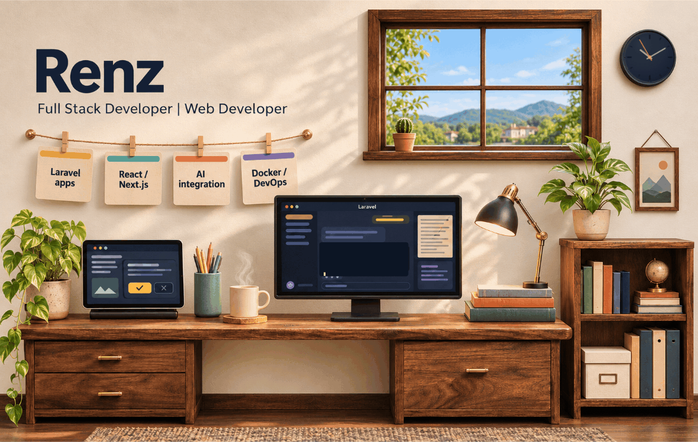
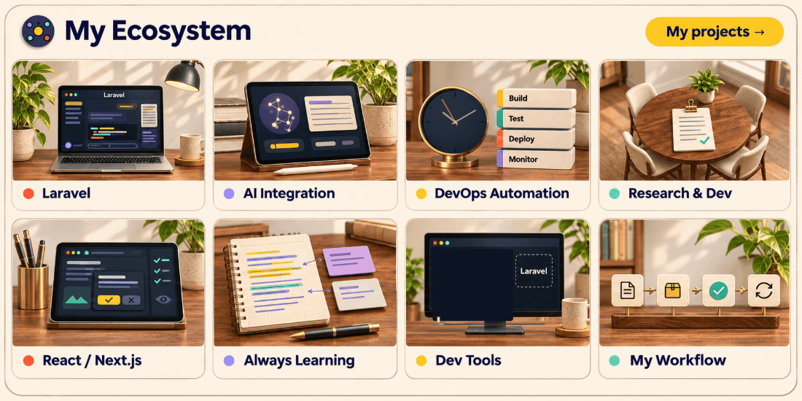

<a href="https://renzcarljansensarucam.vercel.app/">
<picture>
  <source media="(prefers-reduced-motion: reduce) and (prefers-color-scheme: dark)" srcset="https://raw.githubusercontent.com/RenzSarucam/RenzSarucam/main/assets/banner-realistic-dark.png">
  <source media="(prefers-reduced-motion: reduce)" srcset="https://raw.githubusercontent.com/RenzSarucam/RenzSarucam/main/assets/banner-realistic-light.png">
  <source media="(prefers-color-scheme: dark)" srcset="https://raw.githubusercontent.com/RenzSarucam/RenzSarucam/main/assets/banner-animated-dark.gif">
  
</picture>
</a>

<a href="https://github.com/RenzSarucam?tab=repositories">
<picture>
  <source media="(prefers-reduced-motion: reduce) and (prefers-color-scheme: dark)" srcset="https://raw.githubusercontent.com/RenzSarucam/RenzSarucam/main/assets/ecosystem-realistic-dark.png">
  <source media="(prefers-reduced-motion: reduce)" srcset="https://raw.githubusercontent.com/RenzSarucam/RenzSarucam/main/assets/ecosystem-realistic-light.png">
  <source media="(prefers-color-scheme: dark)" srcset="https://raw.githubusercontent.com/RenzSarucam/RenzSarucam/main/assets/ecosystem-animated-dark.gif?v=terminal3">
  
</picture>
</a>

<a href="https://renzcarljansensarucam.vercel.app/">Portfolio</a> &middot; <a href="mailto:renzcarljansen@gmail.com">renzcarljansen@gmail.com</a> &middot; <a href="https://www.linkedin.com/in/renz-carljansen-sarucam-195897314/">LinkedIn</a>

<strong>Renz Carljansen Sarucam</strong> Research &amp; Development Engineer &middot; Full Stack Web Developer &middot; DevOps Engineer &middot; UI/UX Designer

More about me, my stack, and my projects

### About me

I build enterprise web applications with Laravel, React, and Next.js. My current focus includes AI integration, Docker, DevOps, and Cloudflare Tunnel. I'm open to open source collaboration, enterprise web projects, and UI/UX projects.

### Tech stack

| Area | Technologies |
| --- | --- |
| Languages | HTML, CSS, JavaScript, TypeScript, PHP, Python, Java |
| Frontend | React, React Native, Next.js, Vue, Vite, Tailwind CSS, Bootstrap |
| Backend | Laravel, Node.js, Django, Firebase |
| Databases | MySQL, PostgreSQL, MongoDB |
| DevOps & Cloud | Docker, Linux, Bash, Git, GitHub Actions, Cloudflare |
| Design | Figma, Photoshop |

### Featured projects

| Project | Description | Technologies |
| --- | --- | --- |
| **Opsora** | Systems Monitoring & Operations Dashboard | Next.js, Laravel, MySQL, Redis, Docker |
| **Rentora** | Boarding House Management System | TypeScript, JavaScript, PLpgSQL, Python, CSS, Shell, HTML |
| **LiftIQ** | AI-Powered Personal Gym Coach | React Native, Expo, Laravel, MySQL |
| **GTMS** | Gaisano Task Management System | React, TypeScript, Laravel, MySQL |

> Technology is not just about writing code. It's about solving real-world problems through innovation.

